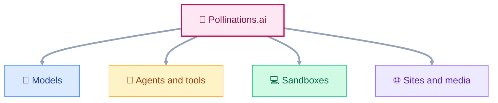

  <picture>
    <source media="(prefers-color-scheme: dark)" srcset="https://raw.githubusercontent.com/pollinations/pollinations/main/packages/ui/src/brand/lockup-stacked-white.svg" />
    
  </picture>

  
Artists and developers build open-source AI tools here. Explore a community app, try a model, or share something of your own.

[Ecosystem](#ecosystem) · [Get involved](#get-involved) · [Playground](https://pollinations.ai/play) · [Community apps](https://pollinations.ai/apps) · [Main repository](https://github.com/pollinations/pollinations)

---

## Ecosystem

| Explore | What you can do |
| --- | --- |
| [Models](https://enter.pollinations.ai/models) | Chat, edit a photo, animate a still, or make music. The same API supports transcription, 3D assets, and embeddings for search. |
| [Community models](https://enter.pollinations.ai/models?q=source%3Acommunity) | Try a model hosted by another builder or connect your own endpoint to the catalog. |
| [Community agents](https://enter.pollinations.ai/agents) and [MCP tools](https://gen.pollinations.ai/docs#tag/mcp-servers) | Give an agent instructions and tools to search the web or work with connected apps. Share it so others can call it by name. |
| [Sandboxes](https://gen.pollinations.ai/docs#tag/sandboxes) | Open a Linux machine in VS Code or over SSH. Run a project, test a change, and preview it with your agent. |
| [Sites](https://gen.pollinations.ai/docs#tag/sites) and [media storage](https://github.com/pollinations/pollinations/blob/main/APIDOCS.md#media-storage) | Publish a static site at `your-name.pollinations.app` or upload media to use in your next model call. |
| [Pollinations Pay](https://gen.pollinations.ai/docs#tag/pollinations-pay) | Let people sign in to your app, set a spending limit, and pay from their own balance. |

## Get involved

- **Share an app.** [Submit it to the gallery](https://github.com/pollinations/pollinations/issues/new?template=app-submission.yml) so others can try it.
- **Publish a model or agent.** [Request publisher access](https://github.com/pollinations/pollinations/issues/new?template=community-model-allowlist.yml), then follow the guide for [models](https://gen.pollinations.ai/docs#tag/publish-a-model) or [agents](https://gen.pollinations.ai/docs#tag/publish-an-agent).
- **Solve an issue.** Pick an [open issue](https://github.com/pollinations/pollinations/issues), test your change, and link it in your pull request. For example, [PR #19797](https://github.com/pollinations/pollinations/pull/19797) fixed [#19792](https://github.com/pollinations/pollinations/issues/19792) so the playground keeps your prompt and settings after sign-in. [Contributor guide](https://github.com/pollinations/pollinations/blob/main/CONTRIBUTING.md)
- **Meet other builders.** Share a project in **#showcase** or ask for help in **#code-help**. [Join Discord](https://discord.gg/k9F7SyTgqn)

### Earnings and Quests

Model publishers earn a share when people use a priced model. App developers can enable earnings on paid requests. [Model pricing](https://gen.pollinations.ai/docs#tag/publish-a-model) · [App earnings](https://gen.pollinations.ai/docs#tag/pollinations-pay)

Each Quest lists a task and its reward. For a coding Quest, link your pull request to the issue. Once maintainers select and merge your fix, claim the reward in the [Quests dashboard](https://enter.pollinations.ai/quests).

## Developer tools

Try a prompt in the [playground](https://pollinations.ai/play), use the [CLI](https://github.com/pollinations/pollinations/tree/main/packages/polli-cli) from your terminal, or add the [SDK](https://github.com/pollinations/pollinations/tree/main/packages/sdk) to a JavaScript, TypeScript, or React app. For a first API call and more examples, see the [API quick start](https://github.com/pollinations/pollinations/blob/main/APIDOCS.md#-getting-started) and [API reference](https://gen.pollinations.ai/docs).

## 📊 Community Stats

<!-- STATS:START -->

| Metric           | Count                                                                                                          |
| ---------------- | -------------------------------------------------------------------------------------------------------------- |
| ⭐ Stars         |                |
| 🍴 Forks         |                |
| 👥 Contributors  |  |
| 🔄 Open PRs      |              |
| 📦 SDK downloads |                              |

<!-- STATS:END -->

## 🏗️ Platform at a glance

## 📣 Stay Connected

  <a href="https://x.com/pollinations_ai">𝕏</a> ·
  <a href="https://instagram.com/pollinations_ai">Instagram</a> ·
  <a href="https://www.linkedin.com/company/pollinations-ai">LinkedIn</a> ·
  <a href="https://facebook.com/pollinations">Facebook</a> ·
  <a href="https://www.reddit.com/r/pollinations_ai/">Reddit</a> ·
  <a href="https://www.youtube.com/c/pollinations">YouTube</a>

## 🌍 Supported By

<!-- website-supporters:start -->
[Alibaba Cloud](https://www.alibabacloud.com/) · [Anthropic](https://www.anthropic.com/) · [AssemblyAI](https://www.assemblyai.com/) · [AWS](https://aws.amazon.com/) · [BytePlus](https://www.byteplus.com/) · [Cloudflare](https://developers.cloudflare.com/workers-ai/) · [Daytona](https://www.daytona.io/) · [DigitalOcean](https://www.digitalocean.com/) · [E2B](https://e2b.dev/) · [ElevenLabs](https://elevenlabs.io/) · [Exa](https://exa.ai/) · [Fireworks AI](https://fireworks.ai/) · [Google Cloud](https://cloud.google.com/) · [InferencePort AI](https://inferenceport.ai/) · [io.net](https://io.net/) · [Lambda](https://lambda.ai/) · [Microsoft Azure](https://azure.microsoft.com/) · [Modal](https://modal.com/) · [Nebius](https://nebius.com/) · [NVIDIA](https://www.nvidia.com/en-us/deep-learning-ai/startups/) · [OpenAI](https://openai.com/) · [OpenRouter](https://openrouter.ai/) · [OVHcloud](https://www.ovhcloud.com/) · [Perplexity](https://www.perplexity.ai/) · [RunPod](https://www.runpod.io/) · [Scaleway](https://www.scaleway.com/)
<!-- website-supporters:end -->

---

  Made with ❤️ in Berlin · <a href="https://github.com/pollinations/pollinations/blob/main/LICENSE">MIT License</a>

